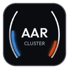
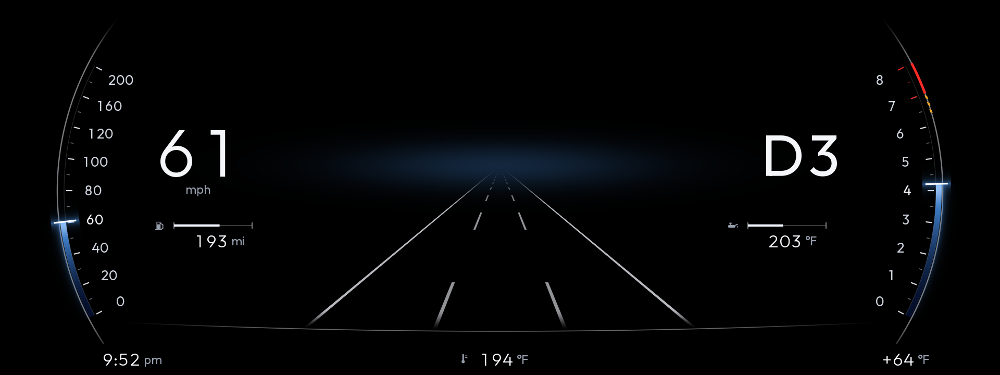
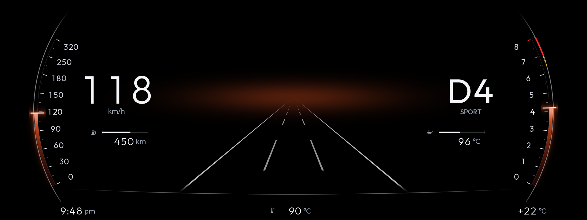
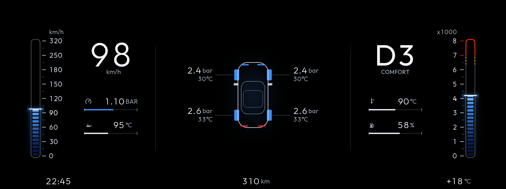
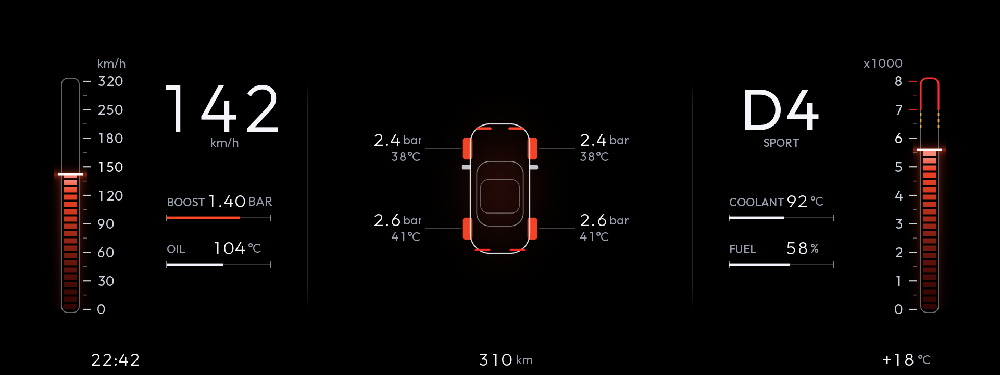
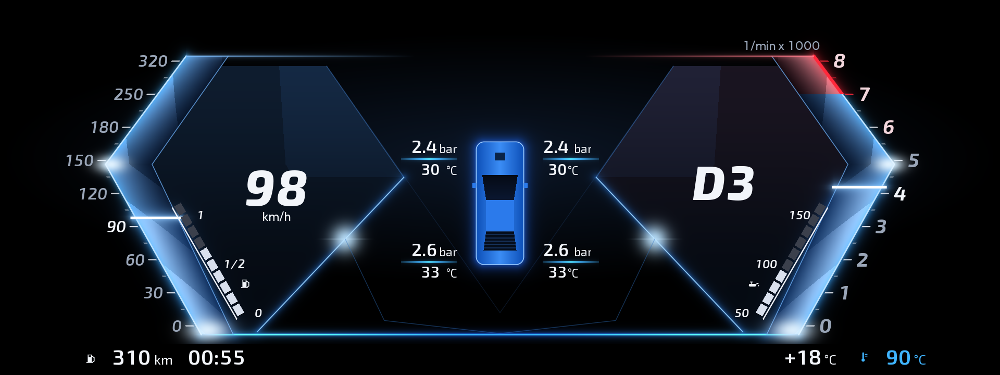
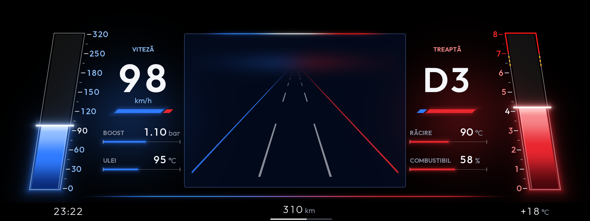
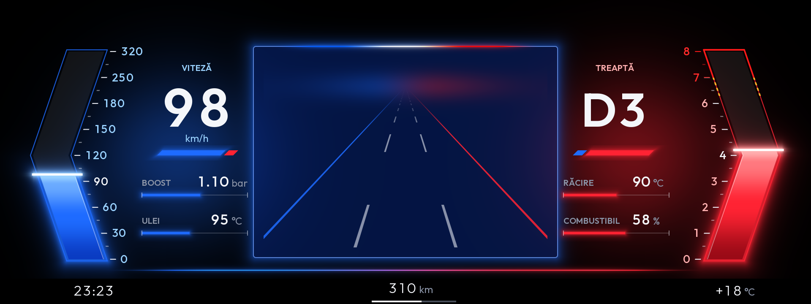

# AAR Cluster Themes



Redraws the whole instrument cluster of a BMW with iDrive 7 (MGU) in a theme of your choice, installed through the community MGU Store. AAR's own themes: **Curved**, after BMW's newer clusters (iDrive 8 / 8.5 Curved Display), **Apex**, a sport dash with light columns for speed and revs and a car seen from above with every tyre's pressure and temperature, **Artifact**, glass chevron frames for speed and revs with the car's tyres or the Waze map (fading to black) in the middle, and **Lame** and **Bumerang**, blue and red blades for speed and revs with the Waze map framed in the middle (straight leaning blades, or boomerangs with stronger colours). Curved's and Apex's colours follow the drive mode: blue in Comfort, orange-red in Sport, red in Sport Plus, teal in Eco Pro. All of bimmer-lab's themes are here too: GT3, M, M view, Vector, Sport, Minimal, Track, Drag, Rally, Retro 80s, Cruise, Dyno and Ribbon. [Read more](apps/aar_cluster_themes/README.md)

AAR Cluster Themes is a fork of [bimmer-lab/apps](https://github.com/bimmer-lab/apps) (Cluster Themes 0.19.0, MIT) with its own app id, `aar_cluster_themes`, so it installs next to bimmer-lab's Cluster Themes without a conflict.

<p align="center"></p>
<p align="center"></p>
<p align="center"></p>
<p align="center"></p>
<p align="center"></p>
<p align="center"></p>
<p align="center"></p>

## Install

1. Install **cluster-render** first, from the `robertnisipeanu/idrive-apps` Store source. If you use Waze on cluster, you have it already.
2. In the MGU Store, go to **Settings, Add source** and enter this repository (`alexarghir98/AAR`). Install **AAR Cluster Themes**.
3. Open **AAR Cluster Themes** from the apps menu on the center screen. Lame is already picked for Comfort, Bumerang for Sport and Curved for Eco Pro, and "Show Waze map inside the theme" is on. Set **Redline** to your engine's. The defaults are for Romania (km/h, 24-hour clock, Eastern Europe time zone); change **Time zone (clock)** elsewhere, as the head unit's clock runs on UTC.
4. Use one cluster app at a time: if bimmer-lab's Cluster Themes is installed too, set it to **Off (BMW's own cluster)**.

The Store builds the app on the car from this repository. No BMW code is in it: the Store makes the oap-sdk from an app already on your head unit. A Romanian guide is in [docs/CURVED-INSTALL-RO.md](docs/CURVED-INSTALL-RO.md).

## Try it on a Mac

```sh
node bench/server.js      # then open http://localhost:8078
```

Needs `node` and `python3`. The bench stands in for cluster-render and the car's signals: pick a theme, press COMFORT / SPORT / SPORT+ / ECO PRO, and move the speed and rpm sliders. See [bench/README.md](bench/README.md) and [docs/DEVELOPING.md](docs/DEVELOPING.md).

## Use at your own risk

This is an unofficial app made by hobbyists. It is not made, approved or supported by BMW.

- Installing apps that don't come from BMW on your head unit is done at your own risk and may affect your warranty.
- The app only reads data from the car. It never writes to or changes any control unit.
- A cluster theme draws over BMW's own cluster. Readouts are for information only: always follow BMW's own warnings. If anything looks wrong, pick Off and BMW's cluster comes back.
- Don't set up or change the app while driving.
- Provided as is, without any warranty, under the MIT licence.

## Credits

- [bimmer-lab/apps](https://github.com/bimmer-lab/apps): Cluster Themes, its drawing engine, themes, bench and tools, which this app is built from (MIT).
- [cauliflowermossgrape/idrive7-apps](https://github.com/cauliflowermossgrape/idrive7-apps): the MGU App Kit (MIT) and the Redline app the shift scoring comes from.
- [robertnisipeanu/idrive-apps](https://github.com/robertnisipeanu/idrive-apps): cluster-render, which draws on the cluster, and the MGU Store.
- Barlow, Michroma, Orbitron, DSEG7 and Outfit typefaces (SIL Open Font License).

## Licence

MIT (LICENSE). Third-party parts are listed in the app's `NOTICE`. Version history: [CHANGELOG.md](CHANGELOG.md).
